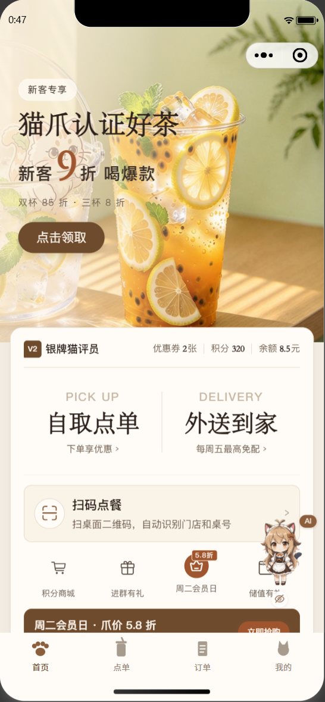
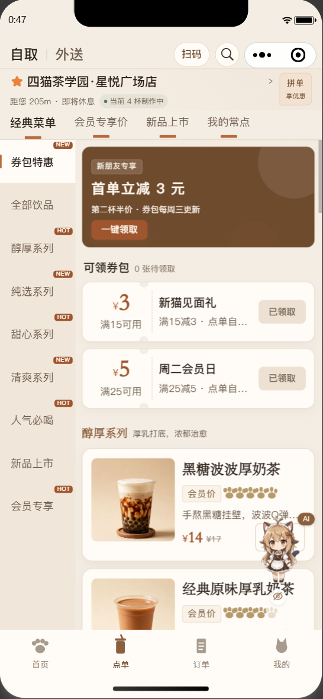
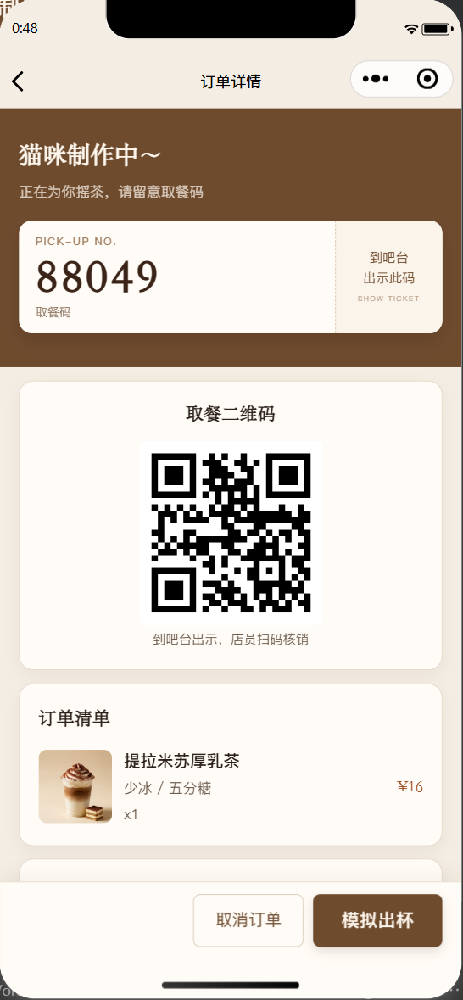
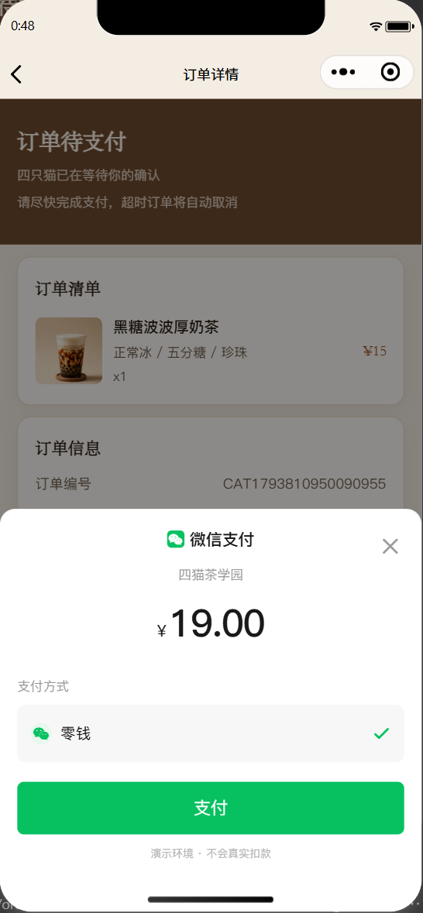
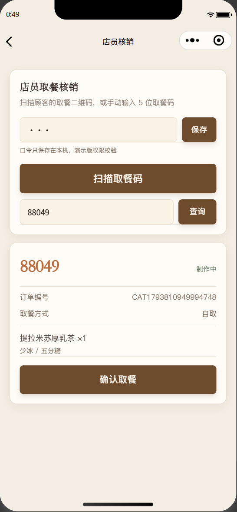
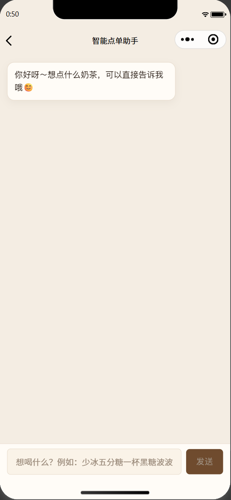
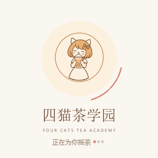
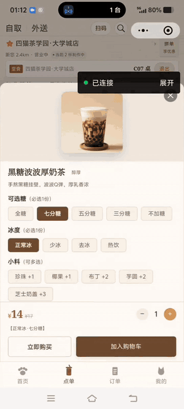
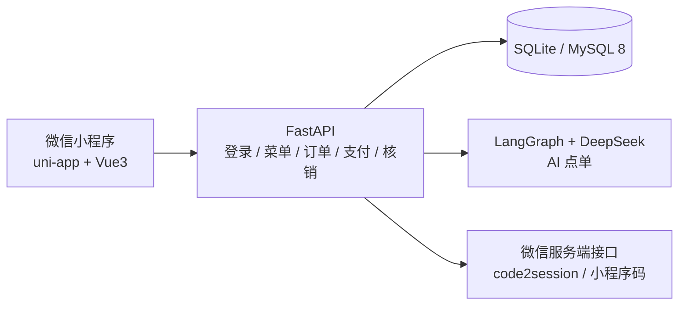

<p align="center">
  
</p>

# 四猫茶学园 · 奶茶点单小程序

> 微信小程序（uni-app + Vue3）+ FastAPI 全栈点单系统  
> 个人项目 / 独立开发 · 课程设计与求职作品集


> 独立开发微信小程序奶茶点单系统：uni-app + Vue3 + FastAPI，打通扫码堂食、订单/优惠券/核销与 AI 自然语言点单，并用条件更新解决库存超卖与重复取消。

> **项目状态：** 本地可运行；界面截图与实机录屏已补；17 个 pytest、并发脚本、MySQL 8 临时库 smoke 通过。

**仓库：** [Gitee](https://gitee.com/keleau/milktea) · [GitHub 镜像](https://github.com/keleau/milktea)

## 30 秒了解

| 项 | 内容 |
|---|---|
| 项目类型 | 微信小程序点单系统（uni-app + Vue3）+ FastAPI 后端 |
| 我的角色 | 个人项目 / 独立开发：数据库、接口、页面、微信能力、AI 助手、测试与文档 |
| 核心链路 | 登录 → 扫码堂食 → 选规格/加料 → 结算 → 支付 → 取餐码/二维码 → 店员核销 |
| 项目规模 | 13 个页面、16 张表、4 条产品线、12 款饮品、3 家门店、22 张桌码 |
| 技术亮点 | 条件 UPDATE 库存/状态一致性、幂等键、LangGraph 工具调用、微信原生能力 |
| 验证结果 | 17 个 pytest；库存为 1 时并发不会超卖；MySQL 8 实库 smoke 通过 |

## 演示入口

| 入口 | 状态 |
|---|---|
| 演示预览 | [▶ 点击直接观看 10 秒 GIF](docs/previews/demo.gif) |
| 完整视频 | [GitHub 文件页](https://github.com/keleau/milktea/blob/main/docs/video/demo.mp4) · [Gitee（需下载后观看）](https://gitee.com/keleau/milktea/blob/main/docs/video/demo.mp4)（95 秒） |

> 录屏建议：登录 → 扫码堂食 → 规格加料 → 提交订单 → 微信支付风格收银台 → 取餐码/二维码 → 店员核销 → AI 点单。
>
> 素材：界面截图、10 秒 GIF 预览和完整录屏已更新。

## 项目截图

> 以下截图来自微信开发者工具**真实运行**，不是设计稿。

| 首页 | 点单 |
|---|---|
|  |  |

| 订单详情（取餐票 + 二维码） | 微信支付风格收银台 |
|---|---|
|  |  |

| 店员核销 | AI 点单 |
|---|---|
|  |  |

## 品牌加载动画

<p align="center">
  
</p>

> 页面加载时使用的品牌动图：猫娘 logo 浮动 + 加载弧旋转 + 项目名与“正在为你摇茶”动态点。GIF 会在仓库页面里自动循环播放。
>
> 小程序端使用同款 256×256 优化版：[loading.gif](fronted/static/resource/images/loading.gif)。

## 实机演示

<p align="center">
  <a href="docs/previews/demo.gif"></a>
</p>

> 上方为 10 秒 GIF 节选，点击可查看完整尺寸；由微信开发者工具真实运行录屏生成，不是设计稿。
>
> 完整视频：[GitHub 文件页](https://github.com/keleau/milktea/blob/main/docs/video/demo.mp4) · [Gitee（需下载后观看）](https://gitee.com/keleau/milktea/blob/main/docs/video/demo.mp4)（95 秒，720×1600）。GIF 可直接播放；GitHub 文件页对 MP4 只提供文件/下载入口，Gitee 的 MP4 需下载后观看。

## 核心亮点

1. **不是页面 Mock，业务真的闭环。** 登录、扫码堂食、菜单规格、购物车、优惠券、会员价、下单、模拟支付、订单状态机、取餐码/二维码、店员核销全部打通；金额、库存、优惠券和状态都由后端计算与落库。
2. **订单一致性是核心难点。** 创建订单时用条件 UPDATE 预占库存，支付/取消/核销用原子状态迁移，优惠券锁定、幂等键、15 分钟超时取消；并发脚本可复现“库存为 1 时不会超卖、重复取消仅回补一次”。
3. **AI 点单不是固定 RAG 管线。** 基于 LangGraph ReAct 的单 Agent + 3 个工具（库存查询、下单、订单查询），支持多轮会话、参数补全、售罄/打烊/重复下单拦截；AI 下单复用普通订单服务，不绕过库存与状态机。
4. **微信能力 + 工程化都有。** `code2session` 登录、`chooseAvatar` / 昵称组件、`scanCode` 扫码、`wxacode.getUnlimited` 小程序码；配套接口文档、数据字典、前后端联调文档，以及 SQLite / MySQL 双库验证。

## 功能清单

- **登录与用户**：微信一键登录（`code2session`）、演示会员登录、微信头像/昵称、会员等级、积分、余额
- **点单**：4 条产品线、12 款饮品、冷热/糖度、加料、门店切换、搜索、推荐、常点
- **扫码堂食**：应用内扫桌码、微信「扫一扫」小程序码直达、自动绑定桌号和门店
- **结算**：自取/外送、收货地址、优惠券、会员价、打包费/配送费
- **订单**：下单幂等、库存预占、待支付 15 分钟自动取消、订单状态机、模拟支付、取餐码/取餐二维码
- **店员核销**：店员口令、扫码或手输取餐码、确认取餐
- **AI 点单**：自然语言查库存、推荐、下单、查订单进度；参数缺失时反问，库存不足/售罄/打烊会拒绝下单
- **会员**：优惠券、积分、地址、常点、订单评价

## 技术栈

| 层 | 技术 |
|---|---|
| 前端 | uni-app + Vue 3 + uni-ui，HBuilderX 工程 |
| 后端 | FastAPI + SQLAlchemy 2 + Pydantic v2 + Uvicorn |
| 数据库 | SQLite（默认）/ MySQL 8（本机临时库 smoke 通过，未压测） |
| AI 点单 | LangGraph + LangChain，DeepSeek Chat（OpenAI 兼容接口） |
| 微信能力 | `code2session`、`chooseAvatar`、`type="nickname"`、`uni.scanCode`、`wxacode.getUnlimited`、access_token 进程内缓存 |
| 测试 | pytest + FastAPI TestClient + 临时 SQLite + MySQL smoke + 并发脚本 |

## 系统流程



## 关键设计（面试可展开）

- **库存与订单**：创建订单时条件 UPDATE 预占库存，支付不重复扣；取消/超时释放。支持旧订单 `stock_reserved=False` 的兼容路径。
- **状态机**：支付、取消、核销、超时取消都用条件 UPDATE 抢占状态，重复回调/重复点击不会重复执行；重复取消保持幂等。
- **优惠券**：锁定、支付核销、取消释放集中在 `app/services/coupons.py`，同一张券不会被两个订单占用。
- **幂等**：前端传 `Idempotency-Key`，后端用 `(user_id, key)` 唯一键；并发冲突返回已创建订单，避免重复下单。
- **AI 边界**：单 Agent + 3 工具的有界 ReAct 循环；prompt 只做引导，真正的库存/参数校验在服务端工具和订单服务里。
- **数据切换**：本机 `.env` 配 MySQL；演示机设 `USE_SQLITE=1` 强制 SQLite，不改代码。

## 工程验证

```bash
cd fastapi_demo

# 测试依赖（pytest / httpx）；只跑项目可只装 requirements.txt
pip install -r requirements-dev.txt

# 17 个 pytest：库存、幂等、取消、超时、券、积分、API smoke/E2E
.venv\Scripts\python.exe -m pytest -q

# 并发证据：最后 1 件库存 / 重复取消
.venv\Scripts\python.exe scripts/concurrency_check.py

# MySQL 8 临时库 smoke：16 表 + 库存/取消/券/积分
.venv\Scripts\python.exe scripts/mysql_check.py
```

并发脚本输出：

```text
[1/2] 最后 1 件库存并发：成功 1 单，库存不足 1 单，库存 0，新增订单 1 笔
[2/2] 同一订单并发取消：取消成功 2 次，库存 0 -> 1，订单状态 cancelled
RESULT: PASS
```

MySQL smoke 会创建 `milktea_test_<时间戳>` 临时库，导入 `schema_mysql.sql`，跑完自动删除，不改动现有 `milktea` 库。

## 快速开始

### 后端

```bash
cd fastapi_demo
python -m venv .venv
.venv\Scripts\activate            # macOS/Linux: source .venv/bin/activate
pip install -r requirements.txt
python database/build_sqlite.py   # 首次生成种子数据库
python -m uvicorn main:app --host 0.0.0.0 --port 8000
```

- Swagger：<http://127.0.0.1:8000/docs>
- 本地 MySQL：在 `.env` 配 `DATABASE_URL=mysql+pymysql://...`
- 演示机没有 MySQL：在 `.env` 加 `USE_SQLITE=1`，强制 SQLite
- 完整配置见 [`fastapi_demo/.env.example`](fastapi_demo/.env.example)

### 前端

1. 用 **HBuilderX** 打开 `fronted/` 目录
2. 安装微信开发者工具，开启「设置 → 安全设置 → 服务端口」
3. HBuilderX → 运行 → 运行到小程序模拟器 → 微信开发者工具
4. 首次进入选择「演示会员登录」（预置会员 1001）

## 项目结构

```text
milktea/
├─ fronted/                         # uni-app 小程序（13 个页面）
│  ├─ pages/                        # 登录/首页/点单/详情/结算/订单/核销/AI...
│  ├─ components/                   # 商品卡、券票、订单商品行、支付收银台...
│  ├─ common/                       # API、请求、状态、工具
│  └─ docs/                         # 接口清单与联调说明
├─ fastapi_demo/                    # FastAPI 后端
│  ├─ app/api/v1/                   # 路由
│  ├─ app/services/                 # 订单、优惠券、定价、核销、AI
│  ├─ database/                     # SQLite / MySQL schema、种子库、桌码
│  ├─ tests/                        # 17 个 pytest
│  └─ scripts/                      # 并发检查 / MySQL smoke
└─ docs/                            # 数据字典
```

## 已知限制

- 支付是**模拟流程**：前端是微信支付风格收银台，后端 `notify` 不验签、直接置为成功；真实微信支付 APIv3 的验签/解密/退款未接入，不能用于生产。
- 未配置微信 AppID 时，微信登录使用 `mock_id` 生成模拟账号；`code=demo` 固定登录演示会员 1001，多台设备会共享订单/积分/券。
- 店员核销使用 `.env` 中的共享口令 `STAFF_PIN`，不是店员账号 + 角色权限；演示版没有 PIN 限流。
- 库存是全门店共享的简化模型，不是每店独立库存；生产应拆 `store_products(store_id, product_id, stock)`。
- 取餐码为 5 位随机码，极端情况下可能重复；扫码核销不受影响，手输重复码会提示改用扫码。
- AI 会话保存在后端进程内存（2 小时），重启会清空；AI 下单只支持单款自取，不会自动支付。
- SQLite 适合演示与单机开发；MySQL 已做临时库 smoke，但未做压测、多实例部署和监控。
- 项目管理后台、真实微信支付、每店库存、线上部署未实现；这是课程设计/求职作品集，不是生产系统。

## 文档

- 接口清单：[fronted/docs/backend-api.md](fronted/docs/backend-api.md)
- 前后端联调：[fronted/docs/frontend-backend-integration.md](fronted/docs/frontend-backend-integration.md)
- 数据字典：[docs/data-dictionary.md](docs/data-dictionary.md)
- 后端联调：[fastapi_demo/docs/backend-frontend-integration.md](fastapi_demo/docs/backend-frontend-integration.md)

## 联系

- 项目仓库：[Gitee](https://gitee.com/keleau/milktea) · [GitHub 镜像](https://github.com/keleau/milktea)
- 实机演示：[10 秒 GIF 预览](docs/previews/demo.gif) · [完整视频（需下载后播放）](docs/video/demo.mp4)

---

> 本项目仅用于学习、课程设计与求职展示。演示数据不是真实商户/用户数据，支付不会真实扣款。
